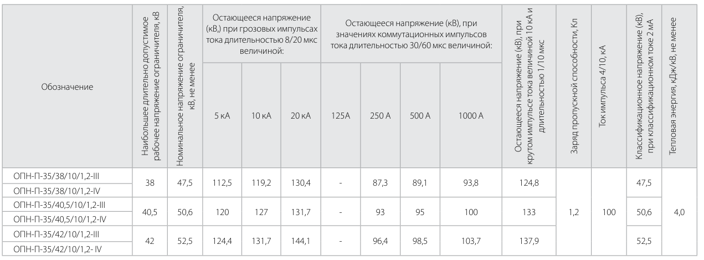
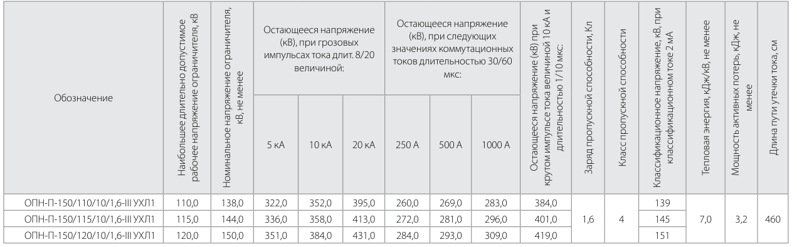
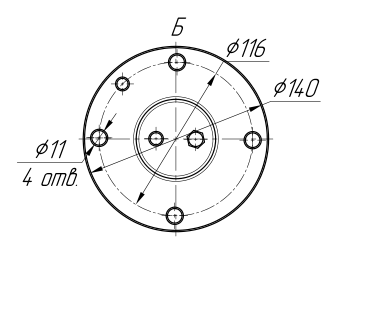
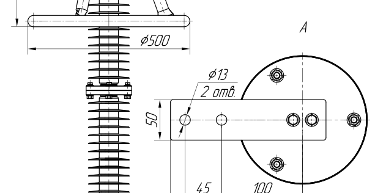
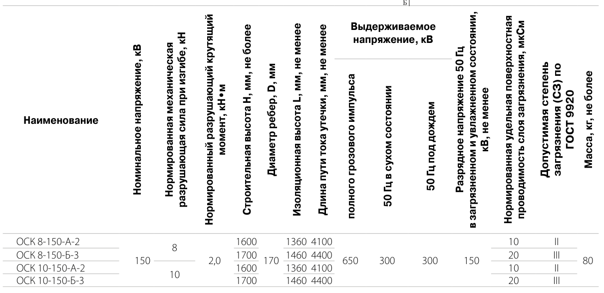

# Project X: разбор на инженерных каталогах

Предварительный документ для автора проекта. 12 октября 2026 года. Проверяем точный перенос сложных PDF в JSON: таблицы, условия измерений, объединённые ячейки и чертежи.

Главный вывод: по имеющимся данным нельзя сказать, что наш инструмент значительно лучше. В первом проходе на одинаковых 17 страницах Project X с GLM получил 411 из 520 проверок данных, наш извлекатель — 399. После исправления известных ошибок оценивания у Project X 6 из 21 проверок чертежей, у нашего — 5. Это один проход; итог нашей связки с проверкой и исправлениями ещё не готов.

Project X полезно продолжать проверять как возможный дополнительный инструмент. Сейчас есть конкретные ошибки оцифровки и полезные архитектурные решения. Наши собственные ошибки и недостатки бенчмарка также показаны ниже.

## 1. Что именно проверено

Один расширенный бенчмарк: 17 трудных страниц из пяти каталогов, 520 выбранных проверок данных и 21 проверка чертежей. Это выборочное покрытие, а не гарантия правильности каждого слова и каждого размера на странице. Повторы свежие: три для каждой конфигурации модели. Вход — исходный PDF; эталонные ответы моделям не передавались.

У Project X отдельно проверены быстрый разбор PDF без модели и подключённый нами штатный сервис Vision. Для каталогов добавлены рендер страницы, перекрывающиеся увеличенные фрагменты и задание на полный JSON. Это адаптация к новой задаче, не оценка неизменённой программы во всех её сценариях. Качество банковских отчётов, поиска и ответов на вопросы здесь не измерялось.

| Результат / стадия | Завершено | Данные / 520 | Чертежи / 21 | Пригодный JSON |

|---|---|---|---|---|

| Наш извлекатель 1.4.2, первый проход | 1 круг показан | 399 | 5 | 15/17 |

| Project X + GLM, Vision v1 | Все 3 круга | 411; 456; 313 | 6; 6; 7 | 14/17; 17/17; 16/17 |

| Project X + MiniMax, Vision v1 | Все 3 круга | 222; 160; 247 | 3; 0; 2 | 4/17; 5/17; 4/17 |

Таблица использует отдельную исправленную оценку 0.3.2: она устраняет известные различия обозначений физических единиц и поддерживает некоторые английские описания геометрии. Исходные JSON и оценки 0.3.0/0.3.1 сохранены. Любая неудачная попытка остаётся нулём на полном знаменателе; не считаем только удачные страницы.

У GLM среднее по проверкам данных — 75,64%, диапазон 60,19–87,69%, выборочное стандартное отклонение 14,06 процентного пункта. По чертежам — 30,16%; пригодный JSON — 47 из 51 попытки. Большой разброс частично связан с несовместимостью вложенных метаданных и нашей схемы каталога; пример ниже.

У MiniMax среднее по проверкам данных — 40,32%, диапазон 30,77–47,50%, выборочное стандартное отклонение 8,61 процентного пункта; по чертежам — 7,94%. Главное ограничение этой интеграции — пригодный JSON только в 13 из 51 попытки. В её Anthropic-подключении JSON задаётся инструкцией, без параметра принудительного JSON-формата провайдера; GLM получает параметр json_object. Поэтому это сравнение конкретных интеграций, а не чистое сравнение моделей в одинаковых условиях генерации.

GLM 5.3 Flash вызывался через Coding Endpoint с низким уровнем рассуждений; MiniMax M3.1 Flash Preview — через подписочный Anthropic endpoint со средним. Лимит ответа — 32768 токенов, температура 1; штатная попытка исправления синтаксиса JSON — одна. Фактически возвращённые имена моделей проверены по ответам.

Первый круг GLM занял 33,2 минуты на 17 попыток, второй — 47,9, третий — 41,0 минуты, включая подготовку и ожидание допуска. Три круга MiniMax — 19,3; 24,7; 18,1 минуты. Время самих запросов и сообщённые провайдером токены сохранены отдельно. Неизвестный расход не подменяется нулём; стоимость в деньгах не измерялась. Наш первый снимок также включает работу очереди и проверки, поэтому его общее время нельзя напрямую считать временем одного извлечения.

[Полные выходы, исходные оценки, время и токены Project X](https://github.com/megamen32/catalog-extraction-benchmark/tree/main/examples/project-x/2026-10-12-native-vision-v1-full)

[Наш первый проход: точные JSON, версии и повторная проверка](https://github.com/megamen32/catalog-extraction-benchmark/tree/main/examples/agent-routing/2026-10-12-mixed-v2/first-pass-round-1)

[Исправленная оценка 0.3.2: отдельные результаты и проверка скачанных файлов](https://github.com/megamen32/catalog-extraction-benchmark/tree/main/examples/offline-regrading/2026-10-12-v032)

## 2. Страница 27: объединённые ячейки стали пустыми

Источник: каталог ОПН, физическая страница 27, верхняя таблица. Значения 38 кВ, прочерк в колонке 125 А и 87,3 кВ в колонке 250 А относятся и к исполнению IV: ячейки объединены на пару строк III/IV.

*Оригинал верхней таблицы страницы 27. Объединения видны по отсутствующим горизонтальным границам внутри пар строк.*

| Проверяемое поле для IV | В оригинале | Project X + GLM, круг 1 |

|---|---|---|

| Рабочее напряжение | 38 кВ, общая ячейка III/IV | null, state=blank |

| Остающееся напряжение при 125 А | Напечатан «-», общая ячейка | null, state=blank |

| Остающееся напряжение при 250 А | 87,3 кВ, общая ячейка | null, state=blank |

Это реальные потери данных. Пустая ячейка, печатный прочерк и значение общей ячейки имеют разный смысл. Если строку IV выгрузить в Excel отдельно, эти параметры исчезнут.

Что улучшить: сохранять границы объединений и явно связывать общую ячейку со всеми покрываемыми строками. Для плоского JSON/Excel можно повторять значение по этим строкам, сохраняя сведения о его исходном объединении. Проверять числа, прочерки и настоящие пустые клетки отдельно.

[JSON и подробные проверки страницы 27](https://github.com/megamen32/catalog-extraction-benchmark/tree/main/examples/project-x/2026-10-12-native-vision-v1-full/glm-5.3-flash/round-1/catalog-1-page-027)

## 3. Страница 39: правильные данные и настоящая ошибка геометрии

На этой странице важно отделить ошибку программы от ошибки оценивания. Значения 260,0; 272,0; 284,0 кВ под условием 250 А, 30/60 мкс в JSON находятся правильно. Исходный оценщик не распознал латинскую A в названии условия. Это исправлено в оценке 0.3.2.

*Оригинал таблицы страницы 39. Колонка 250 А относится к коммутационному импульсу длительностью 30/60 мкс.*

Описание нижнего вида Б также верно: «bolt-circle diameter ⌀116, flange diameter ⌀140, four holes ⌀11 ... on the bolt circle». Ø116 относится к окружности центров отверстий, Ø140 — к наружному фланцу, четыре отверстия имеют Ø11. Русскоязычные шаблоны старой оценки ошибочно помечали часть этого описания пропущенной. Источник и эти утверждения независимо сверены вторым агентом.

*Оригинал вида Б: наружный контур и окружность центров отверстий — разные объекты.*

Настоящая ошибка находится в другом описании: «⌀500 is the cross-arm tube diameter». В оригинале размер Ø500 проведён по наружным границам верхнего круглого элемента, видимого также в виде А. Это не диаметр сечения трубы. Цифра прочитана правильно, но приписана неверному объекту.

*Оригинал Ø500: размер по наружным границам верхнего круглого элемента; справа его вид А.*

Что улучшить: для каждого размера хранить не только строку «Ø500», но и вид, измеряемый объект или пару конечных точек, ссылку на фрагмент оригинала и неоднозначность. Проверяющий должен искать ошибочную принадлежность размера. Простая проверка наличия правильного числа её не обнаружит.

Материал на странице не указан. Формулировка «porcelain-style housing» — аналогия внешнего вида, а не прямое утверждение «изготовлен из фарфора». Для точного каталога лучше описывать видимые рёбра и оставлять материал неустановленным. Строгая проверка отсутствия неподтверждённых упоминаний материала учитывает такую аналогию отдельно; не приписываем программе более сильное утверждение, которого она не делала.

[JSON и сохранённые первоначальные проверки страницы 39](https://github.com/megamen32/catalog-extraction-benchmark/tree/main/examples/project-x/2026-10-12-native-vision-v1-full/glm-5.3-flash/round-1/catalog-1-page-039)

## 4. Страница 78: число есть, но условие измерения склеено

Источник: каталог инновационных изделий, физическая страница 78. В первой таблице три условия выдерживаемого напряжения: полный грозовой импульс — 650 кВ; 50 Гц в сухом состоянии — 300 кВ; 50 Гц под дождём — 300 кВ.

*Оригинал первой таблицы страницы 78. У общего заголовка напряжения три отдельных дочерних столбца.*

В первом круге GLM склеил два первых условия в столбец «полного грозового импульса 50 Гц в сухом состоянии» со значением 650. Отдельного поля для 300 кВ в сухом состоянии нет; поле под дождём осталось. Всего получается 14 столбцов вместо исходных 15. Это реальная потеря структуры, даже если все отдельные числа встречаются где-то в результате.

Что улучшить: хранить цепочку родительского и дочернего заголовка и проверять число листовых столбцов. Проверка должна сопоставлять тройку «параметр + условие + значение», а не просто искать 650 или 300 в тексте.

Ещё один реальный дефект: на чертеже напечатано H±2, а в описании первого круга GLM — H+2. Потерян минус двустороннего допуска. Эта ошибка пока не входит в текущие 21 проверки чертежей; она внесена в список следующего расширения, без изменения уже запущенного набора.

*Увеличенный оригинал обозначения H±2 на странице 78.*

При этом 4M16 вместо 4М16 — различие латинской и кириллической буквы одинакового вида в обозначении метрической резьбы, а не другое число отверстий или другой размер. Исправленная оценка отличает физическую эквивалентность от буквального совпадения и сохраняет исходное написание. Аналогично СЗ — сокращение «степень загрязнения», а С3 заканчивается цифрой 3: это опечатка заголовка, но при полном названии поля и верных II/III её нельзя автоматически выдавать за неверную числовую характеристику изделия.

[JSON и проверки страницы 78](https://github.com/megamen32/catalog-extraction-benchmark/tree/main/examples/project-x/2026-10-12-native-vision-v1-full/glm-5.3-flash/round-1/catalog-4-page-078)

## 5. Надёжность JSON: отдельно от способности прочитать таблицу

В трёх кругах MiniMax было 31 синтаксически невалидное завершение после штатной попытки исправления JSON, 6 отказов проверки формата штатного анализа и 1 отказ проверки вложенной страницы каталога. Все 38 неудачных выдач сохранены; не исправляли ответы вручную по эталону.

Причины относятся к использованному подключению и расширению под каталог. JSON-only инструкция не гарантирует закрытые скобки, правильную вложенность или нужные имена полей. Штатный визуальный анализ может успешно принять свободные метаданные, а вложенный JSON каталога всё ещё содержать ошибку: в одном ответе GLM появилось column_id_id вместо column_id.

В третьем круге GLM страница 78 успешно принята штатным сервисом анализа, но не прошла нашу схему каталога из-за двух дополнительных полей merged_cell_notes. Поэтому в основном отчёте она получила ноль. Это несовместимость нашей адаптации форматов, не доказательство, что все значения на странице неверны. В отдельной диагностической проекции убраны только эти поля из проверяемого представления, а их содержимое сохранено отдельно: без изменения ячеек, заголовков или рисунков получено 98/140 проверок данных. Диагностика не заменяет исходный результат и не является новым вызовом модели.

Что улучшить: проверять отдельную строгую схему страницы и таблиц до объявления о готовности каталога; разбивать крупные таблицы на части с идентификаторами строк и столбцов; отдельно исправлять синтаксис, формат и фактические ошибки. Сохранять каждый ответ, расход и причину сбоя. Выбор API и способ задания JSON-формата должен быть частью версии интеграции.

## 6. Что у Project X полезно

В исходном проекте есть полезная архитектура: привязка документа и визуальных объектов к источнику, типизированные результаты анализа, ограниченный контекст с происхождением выбранных блоков, ограничения уверенности для приближённых визуальных выводов и отдельные сохраняемые артефакты. Это подтверждено чтением кода, но не означает, что каждый сценарий проекта уже протестирован нашим набором.

Быстрый разбор PDF без модели завершил все 51 попытки за три круга: примерно 2,2 секунды на страницу. Он отдаёт структурные блоки и сетки таблиц. Его исходная оценка готовых каталожных полей — 21/520 и 0/21 в каждом круге: на этих PDF ему не хватает повёрнутых многоуровневых заголовков, условий и геометрии. Быстрая первичная раскладка всё равно может быть полезным входом для следующего агента.

Векторные чертежи этих каталогов не дали штатному инвентарю встроенных изображений полезных визуальных объектов. Поэтому для Vision в нашей адаптации пришлось добавить рендер страницы. Этот переход стоит сделать явным: если прямой разбор не даёт нужной структуры или на странице есть векторный чертёж, агент получает изображение исходной страницы и увеличенные фрагменты.

## 7. Стоит ли подключать его к нашему агенту

Полностью заменять наше решение или отбрасывать Project X по нынешним данным рано. У Project X с GLM хорошие результаты извлечения на части сложных таблиц; после исправления оценивания его первый проход немного выше нашего. Большого проверенного преимущества нашего инструмента нет. Для чертежей обоим решениям нужны дополнительные проверки.

Практичный вариант — отдельный инструмент для первичного разбора документа или получения альтернативного кандидата JSON. MCP даст агенту вызываемый инструмент, скилл объяснит, когда его применять; их можно собрать в Agent Plugin 1.0. Сам формат упаковки точность не повышает.

Описание для агента должно быть конкретным: использовать для структурного разбора цифрового PDF и второго независимого кандидата; результат считать предварительным; при повёрнутых шапках, пропавших столбцах, объединениях или векторной графике обращаться к оригиналу через Vision; сохранять страницу, источник и версию; не принимать правильное число без правильного условия или объекта.

Включать такой инструмент обязательным этапом всей оцифровки стоит после отдельного измерения прибавки: одинаковая исходная связка с инструментом и без него, по три повтора на том же наборе. Это следующий эксперимент, не новый запуск уже идущего сравнения. Пока нет доказательства, что дополнительный вызов улучшает итоговый проверенный каталог.

## 8. Что можно взять из catalog-to-json

Отдельные роли извлечения и независимой проверки; работа с оригиналом и фрагментами страницы через инструменты; явные значения, пустоты, прочерки, единицы и условия; сохранение результата с версией и привязкой к источнику; возобновление после сбоя и повторяемый бенчмарк. При переносе идей важно помнить: проверяющий тоже ошибается, и наши текущие первичные JSON не равны принятому результату после проверки.

[Наш публичный проект catalog-to-json](https://github.com/megamen32/catalog-to-json)

[Публичный бенчмарк и эталонные случаи](https://github.com/megamen32/catalog-extraction-benchmark)

## 9. Что ещё не закончено

Для Project X завершены три свежих круга с GLM и три с MiniMax: 102 попытки на одном наборе. Наша связка извлекатель 1.4.2 → проверяющий 1.4.8 продолжает свежие круги с обычными исправлениями. Первый круг завершился по общему бюджету без принятого результата: сохранились черновики и неудачные попытки; это не успешная доставка всех страниц.

Во втором круге нашей связки уже появился первый принятый случай. Это не меняет результат первого круга и ещё не является завершённой оценкой всех 17 страниц.

Исторические три повтора версий 1.4.2, 1.4.4 и 1.4.6 были на 15 страницах/500 проверках: средние 94,13%; 70,27%; 92,67%. Они сохранены отдельно и не используются как оценки нынешних 17 страниц. Новые изменения очереди и отдельные пробные версии также не наследуют эти проценты автоматически.

Повторный ручной просмотр подтверждает примеры выше; страница 39 дополнительно проверена независимым агентом. Исправленный оценщик поддерживает перечисленные физические обозначения и некоторые английские формулировки, но не является универсальным пониманием любых описаний. Полноту и отсутствие всех возможных ошибок мы ещё не доказали.

Исходный код и настоящее имя частного проекта не публикуются. Все публичные результаты подписаны Project X; исходные каталоги публичные. Ссылки ведут на анонимизированные результаты и наш код.
