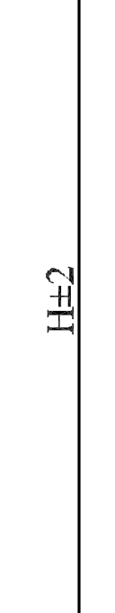

# Catalog Vision Backend: preliminary native Vision integration

> [Catalog Vision Backend](../../../docs/CATALOG-VISION-BACKEND.md) — наша закрытая адаптация; репозиторий приватный, доступ по запросу владельцу; планируем предоставлять бесплатно. Оценки ниже относятся к сохранённым конфигурациям испытаний, а не к новому запуску переименованного форка.

Both GLM 5.3 Flash and MiniMax M3.1 Flash Preview produced artifacts accepted by the native visual-analysis service on catalogue page 78. A private provider adapter supplies the native JSON contract to the models and renders vector pages as three source-bound images. A generic catalogue transcription task stores tables in the native analysis metadata. The upstream source and adapter code remain private.

| Model | Selected engineering checks on page 78 | Native service time | Input tokens | Output tokens |
|---|---:|---:|---:|---:|
| MiniMax M3.1 Flash Preview, medium effort | 108/140 (77.14%) | 50.755 s | 10,682 | 10,742 |
| GLM 5.3 Flash, low effort | 136/140 (97.14%) | 106.563 s | 10,721 | 7,872 |

These are **one attempt per model**, not a three-round benchmark or a stable model ranking. Both models used the same original page, image preparation, task and native output contract. The actual responses identify the requested models and come from the respective Coding endpoints. Reasoning is included in output tokens: 2,037 for MiniMax and 267 for GLM. MiniMax also reports 189 cache-read tokens separately; GLM reports zero cached tokens. No billing cost is inferred.

The deterministic canonical document still contains no table on page 78. The accepted visual analysis is a separate artifact; its `structured_data.metadata.catalogue_page` contains the extracted tables and is exported without rewriting values for independent grading. Each output has two tables of the expected shape: 4×15 and 10×8. This is a **modified native Vision integration**, distinct from the earlier deterministic-parser-only profile.

The MiniMax output joins insulation height and creepage text, then shifts some values into another column. Its score also loses eight strict literal checks for Latin `M` instead of Cyrillic `М` in `4М16`; these letters look identical, and the original literal scores are retained. GLM's four missing checks concern the pollution-class header: it transcribes source `СЗ` as `С3`, so the conservative grader does not match that field even though the row values are present.

The 140 selected checks do **not** establish full drawing accuracy. Both outputs misread the printed tolerance `H±2`: MiniMax writes `H+2`, GLM writes `Н=2`. The source crop below confirms the sign. This is recorded as a future drawing case without changing the frozen dataset.

Separate MiniMax probes on pages 27 and 39 failed native JSON parsing after the native model-assisted syntax repair. All four actual calls, their time and reported token usage are included in [results.json](results.json); the failed attempts are not omitted. Raw provider responses, reasoning and request histories remain private. Earlier successful GLM transport smokes did not satisfy the native analysis contract and are not included as accepted outputs.

The [results and artifact hashes](results.json) retain the accepted native analyses, exported page JSON and full grader reports. Source values were not manually corrected. All public participant labels are **Catalog Vision Backend**.
